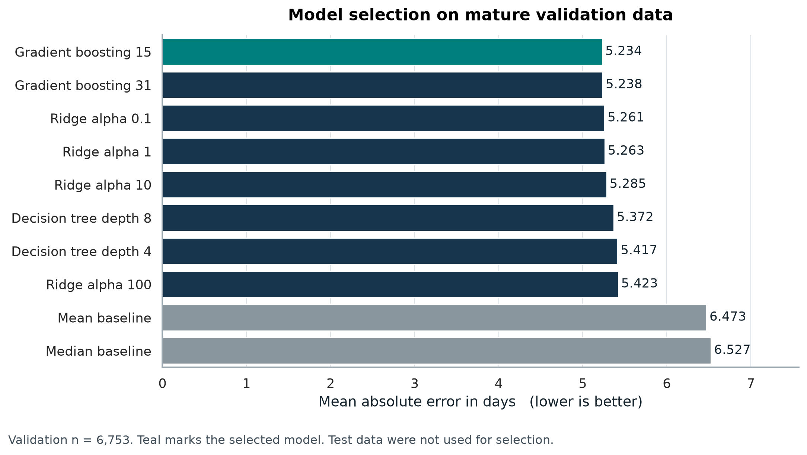
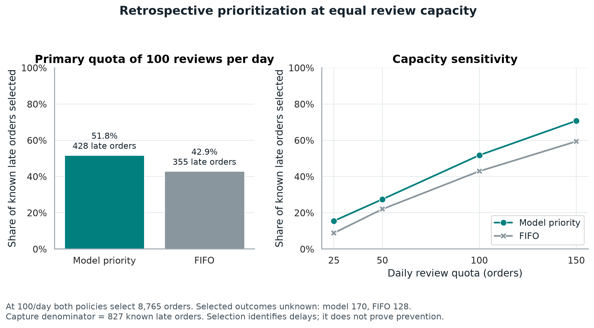

# LogiTrack Logistics Data Analytics

**A four-week project by Rida Sahin** covering delivery reliability, data preparation, exploratory analysis, predictive modeling, and constrained order-review allocation.

The business scenario is a hypothetical ecommerce marketplace whose operations team needs to understand delivery performance and prioritize limited review capacity. Historical Olist records provide the empirical benchmark. A separate 2,000-shipment simulation illustrates assumed cost relationships and a delivery prediction experiment.

## Four connected stages

| Week | Focus | Completed work | Report |
|---|---|---|---|
| [Week 1](week-1-planning/) | Planning | Scenario, KPIs, research, data plan, and Python illustrations | [Word report](week-1-planning/Week_1_Report.docx) |
| [Week 2](week-2-data-preparation/) | Data preparation | Acquisition, cleaning, missing values, outlier treatment, feature preparation, and validation | [Word report](week-2-data-preparation/reports/Week_2_Report.docx) |
| [Week 3](week-3-analysis-visualization/) | Analysis and visualization | Distributions, trends, correlations, bottlenecks, eight embedded figures, and interpretations | [Word report](week-3-analysis-visualization/Rida_Sahin_Week_3_Logistics_Analysis_and_Visualization_Report.docx) |
| [Week 4](week-4-modeling-optimization/) | Modeling and optimization | Ten candidate regressors, chronological evaluation, six embedded figures, and a review-allocation experiment | [Word report](week-4-modeling-optimization/reports/Rida_Sahin_Week_4_Predictive_Modeling_and_Optimization_Report.docx) |

**Workflow:** project plan → prepared order data → descriptive evidence → predictive evaluation and allocation.

Week 3 and Week 4 reuse the order data prepared in Week 2. Week 4 also reuses Week 3's separate hypothetical shipment dataset. Each weekly folder retains its own scripts, inputs, results, pinned dependencies, and submission description so it can be reviewed independently.

## Selected findings

| Finding | Measured result | Population and interpretation |
|---|---:|---|
| Historical on-time delivery | 93.23% | 89,936 of 96,470 eligible completed orders |
| Median purchase-to-delivery cycle | 10.22 days | 96,470 eligible historical orders |
| Predictive test MAE | 4.667 days | 19,654 eligible test deliveries; median baseline MAE 5.397 days |
| Predictive test RMSE | 6.641 days | Larger errors receive greater weight |
| Predictive test R squared | 0.257 | A regression score, not percentage accuracy |
| Late cases identified at 100 reviews/day | 428 versus 355 | Model ranking versus FIFO, both selecting 8,765 approvals |

The model comparison selects histogram gradient boosting with 15 leaves using mature validation MAE. Its advantage over Ridge is small. Long delays remain difficult: all 488 test deliveries lasting more than 30 days are underpredicted. Allocation results describe retrospective identification; intervention benefits and financial savings require a controlled operational pilot.

## Explore and reproduce

1. Open the relevant weekly folder and read its README.
2. Download its Word report for the complete methodology, findings, and interpretation.
3. Inspect the saved result tables and chart files; these do not require running Python.
4. To reproduce a week, use a separate Python environment, install that folder's `requirements.txt`, and follow its README from within that folder.

Python 3.12 was used for the completed analysis. The scripts accept compressed CSV inputs directly. Week 2 source acquisition requires internet access; prepared inputs are already provided for later weeks. Rerunning analysis updates result files, but does not automatically rewrite the Word reports.

| Stage | Main tools |
|---|---|
| Planning and preparation | Python, pandas, NumPy |
| Week 3 figures | ReportLab, with Poppler for PNG conversion |
| Week 4 modeling | scikit-learn, pandas, NumPy, SciPy, joblib |
| Week 4 figures | Matplotlib and Seaborn |

## Data and analytical boundaries

The implemented workflow uses [Olist's official public data repository](https://github.com/olist/work-at-olist-data) at commit `d9e49802f3e92d09ee94ab9ccc5e457f207a8959`, retrieved on 22 October 2026. Week 1 considered the public Olist/Kaggle source; the later implementation pins the official repository. See [data sources and attribution](DATA_SOURCES.md) for the precise lineage and source license.

- The order audit retains 99,441 records. Metric populations vary with valid observed milestones and are explicitly reported.
- Historical features are assumed available at approval; the source does not contain versioned operational snapshots.
- Chronological validation and a 60-day follow-up rule reduce leakage and unequal outcome maturity. They do not remove completed-outcome selection bias.
- Recorded freight is a customer charge, not measured carrier operating cost.
- The 2,000 hypothetical shipments are generated separately and never pooled with historical observations.
- Clustering, live vehicle routing, production deployment, and a controlled intervention pilot remain future work.

## Submission materials

Each week's folder contains the corresponding Word report and `Submission_Description.txt`. All four weeks belong to this repository. The weekly folders provide direct review locations for the internship submissions.

## Verification

The weekly analysis includes independent numerical checks. Week 4 verification reconstructs cohorts from raw timestamps, recomputes prediction metrics, and checks all eight policy/capacity comparisons. The repository assembly preserves original dataset and report bytes and records package provenance in [ASSEMBLY_MANIFEST.json](ASSEMBLY_MANIFEST.json). File integrity can be checked using `python verify_repository.py` from the repository root.
